<div align="center">

<sub>Agrupación</sub>

# Pura Armonía

**— con sabor —**

_Cumbia boliviana ao vivo em São Paulo, Brasil_

[YouTube](https://www.youtube.com/@puraarmonia) ·
[Facebook](https://www.facebook.com/agrupacion.pura.armonia) ·
[Instagram](https://www.instagram.com/agrupacionarmonia) ·
[TikTok](https://www.tiktok.com/@gris_pura_armonia) ·
[WhatsApp](https://wa.me/5511967737231)

</div>

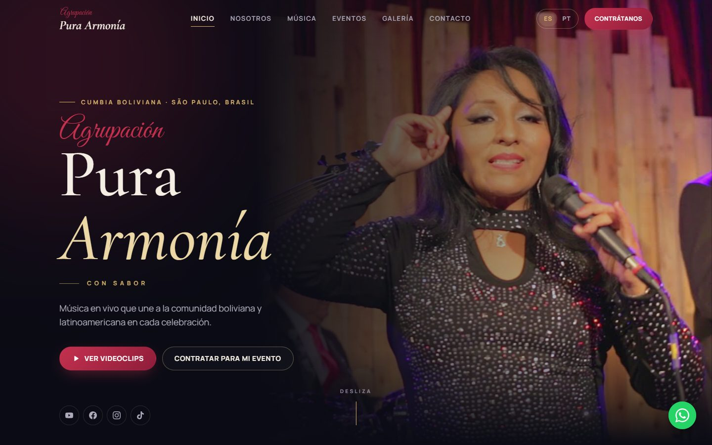

## A banda

A **Agrupación Pura Armonía** é um grupo de música ao vivo de **São Paulo**. A banda nasceu para oferecer uma nova opção musical à comunidade boliviana e latino-americana da cidade. São **7 músicos no palco**, de camisa vinho e gravata, e com muita cumbia.

| | |
| --- | --- |
| 🎶 **Gêneros** | Cumbia boliviana, cumbia romântica, cumbia norteña, tex-mex, baladas e músicas próprias |
| 🎬 **Videoclipes oficiais** | _Par de anillos_ (2023) · _Tu falta de querer_ · _Un nuevo amor_ (letra de Grisel Maria) |
| 🎤 **Ao vivo e sessões** | Mix Frontera, Mix Selena, _Cuéntale_ (piano e voz), ensaios e repertório ao vivo |
| 💍 **Eventos** | Casamentos, festas de 15 anos, festas e prestes, aniversários, eventos corporativos, shows e casas noturnas |
| 📍 **Base** | São Paulo – SP, Brasil |
| 📞 **Contato** | WhatsApp [+55 11 96773-7231](https://wa.me/5511967737231) |

## O site

Site oficial da banda em **espanhol e português**. Ele reúne:

- **Videoclipes** com player embutido e filtros por tipo de vídeo: oficiais, ao vivo e mixes, sessões.
- **Eventos**, com os tipos de festa atendidos e como contratar a banda em 3 passos.
- **Galeria** de fotos, que abrem em tela cheia e podem ser navegadas pelo teclado.
- **Formulário de contato** que monta a mensagem e abre o WhatsApp com tudo preenchido.

### Desktop

<table>
  <tr>
    <td>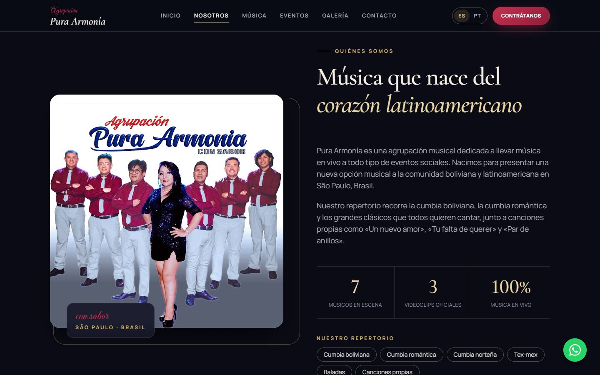</td>
    <td>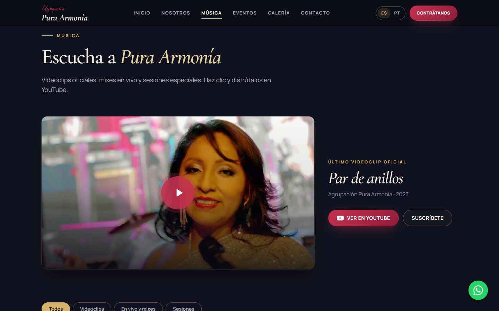</td>
  </tr>
  <tr>
    <td align="center"><sub>Quem somos</sub></td>
    <td align="center"><sub>Música</sub></td>
  </tr>
  <tr>
    <td>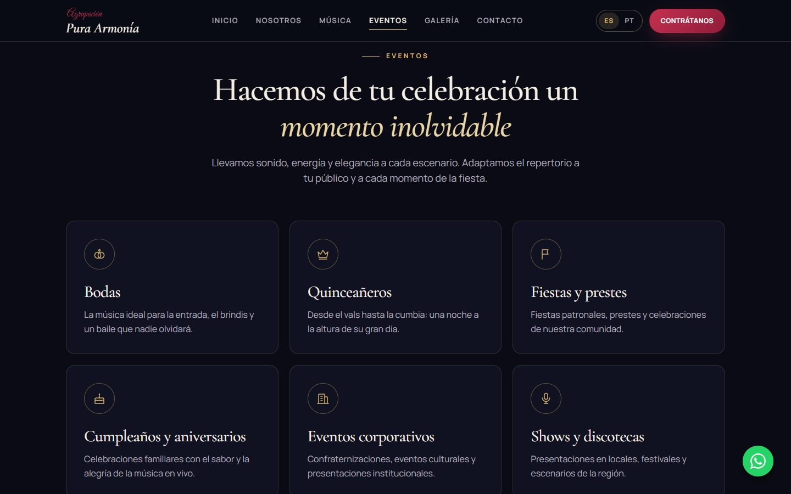</td>
    <td>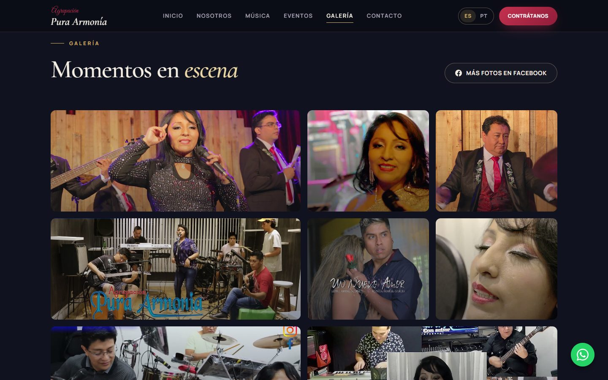</td>
  </tr>
  <tr>
    <td align="center"><sub>Eventos</sub></td>
    <td align="center"><sub>Galeria</sub></td>
  </tr>
  <tr>
    <td colspan="2">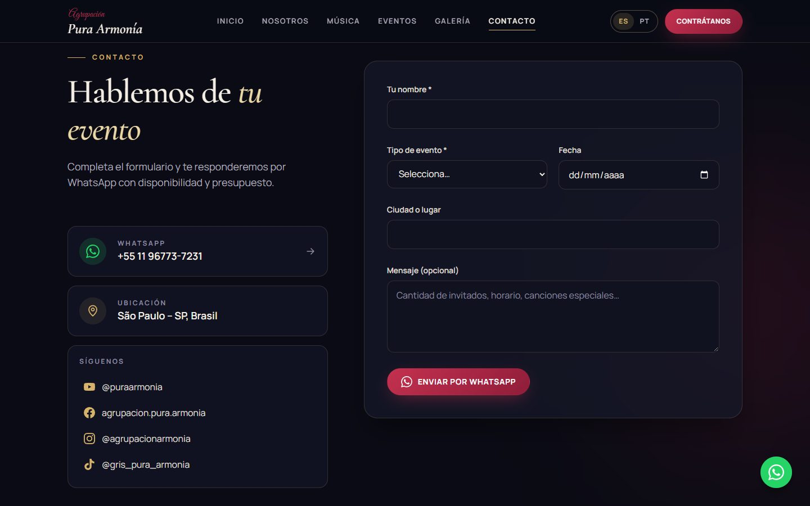</td>
  </tr>
  <tr>
    <td colspan="2" align="center"><sub>Contato</sub></td>
  </tr>
</table>

### Celular

<table>
  <tr>
    <td>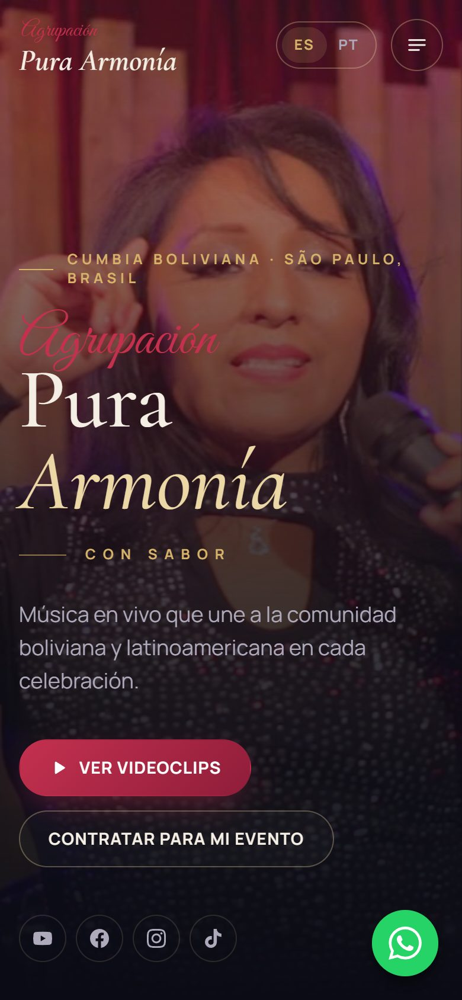</td>
    <td>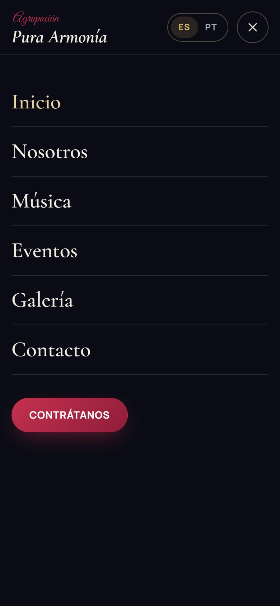</td>
    <td>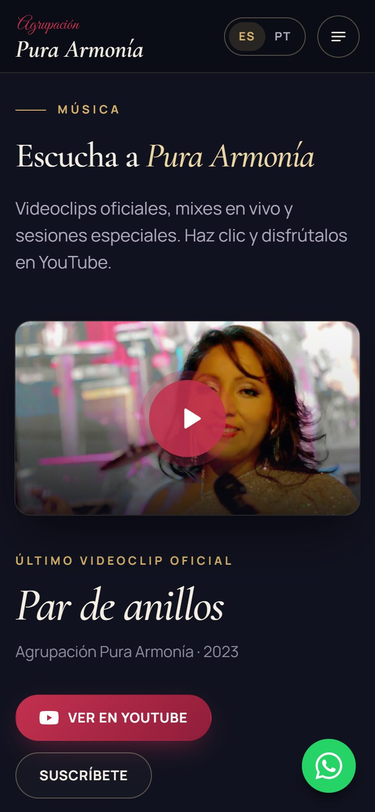</td>
    <td>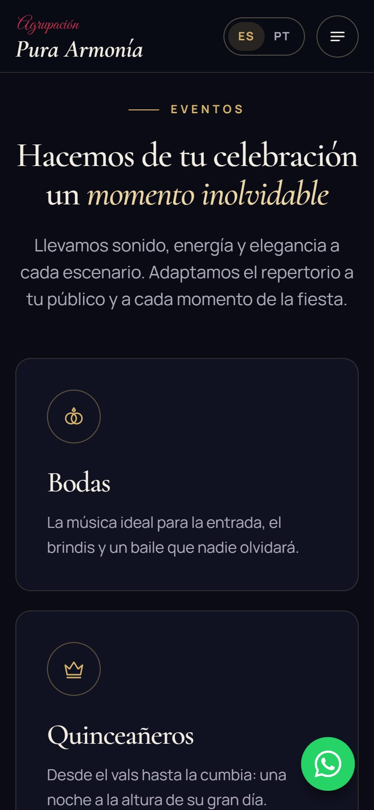</td>
    <td>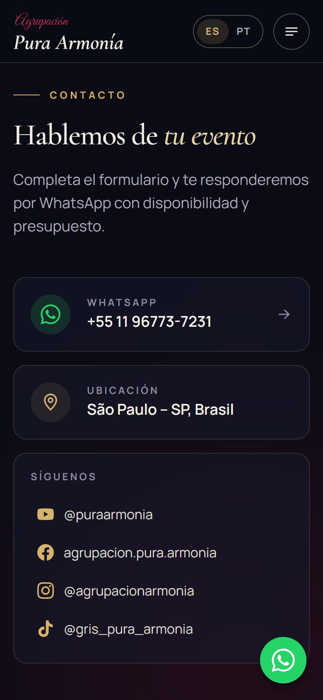</td>
  </tr>
  <tr>
    <td align="center"><sub>Início</sub></td>
    <td align="center"><sub>Menu</sub></td>
    <td align="center"><sub>Música</sub></td>
    <td align="center"><sub>Eventos</sub></td>
    <td align="center"><sub>Contato</sub></td>
  </tr>
</table>

### Identidade visual

A paleta foi tirada da própria banda: o **vinho** das camisas, o **azul-noite** do logo e o **dourado champagne** do brilho de palco. Os títulos usam _Cormorant Garamond_, o "Agrupación" usa _Great Vibes_ (lembrando o logo) e o texto corrido usa _Manrope_.

---

## Parte técnica

**Stack:** Angular 22 (standalone, zoneless, signals, Signal Forms) · Tailwind CSS 4 · página pré-renderizada no build (SSG) · Vitest · sem backend.

### Rodar localmente

```bash
npm install
npm start          # http://localhost:4200
npm run build      # gera o HTML pré-renderizado em dist/pura-armonia/browser
npm test           # testes unitários (Vitest)
```

### Onde editar o conteúdo

| O que mudar | Arquivo |
| --- | --- |
| WhatsApp, redes sociais, cidade | `src/app/core/band.data.ts` (`BAND`, `SOCIAL_LINKS`) |
| Lista de vídeos / vídeo em destaque | `src/app/core/band.data.ts` (`VIDEOS`, `FEATURED_VIDEO_ID`) |
| Fotos da galeria | `public/images/gallery/` + `GALLERY` em `band.data.ts` |
| Foto principal (hero) | `public/images/hero.jpg` |
| Textos em espanhol / português | `src/app/core/i18n/es.ts` e `pt.ts` |
| Cores | `src/styles.css` (bloco `@theme`) |
| Fontes | `public/fonts/` + `@font-face` em `src/styles.css` |

Para adicionar um vídeo novo, copie o ID do link do YouTube (`youtube.com/watch?v=ESTE_ID`) e adicione uma linha em `VIDEOS`.

### Estrutura

```
src/app/
├── core/            dados da banda, i18n (es/pt), utilitários (WhatsApp, YouTube, scroll spy)
├── shared/          componentes reutilizáveis: icon, section-heading, social-links, field-error, diretiva reveal
├── layout/          header, mobile-menu, language-switcher, footer, whatsapp-button
└── sections/
    ├── hero/
    ├── about/
    ├── music/       video-player, video-card, video-filters
    ├── events/      event-card, hiring-steps
    ├── gallery/     lightbox
    └── contact/     contact-form (+ inquiry-message), contact-channels
```

Cada componente tem o `.ts` (lógica) e o `.html` (template) em arquivos separados. O estilo é feito com classes do Tailwind.

### SEO

- O conteúdo é pré-renderizado no build, então o HTML já chega pronto ao navegador e ao Google, e a primeira pintura é mais rápida.
- O idioma pré-renderizado é o espanhol. No navegador, o site troca para o idioma salvo ou o do navegador.
- Meta description, Open Graph e dados estruturados (`MusicGroup` em JSON-LD) estão em `src/index.html`.
- As fontes ficam no próprio site e são pré-carregadas, sem depender do Google Fonts.

### Acessibilidade

- O menu móvel e o visualizador de fotos usam `<dialog>` nativo: o foco fica preso dentro, o Esc fecha e o foco volta para onde estava.
- Há um link "pular para o conteúdo", e as cores têm contraste AA.
- Os erros do formulário ficam ligados aos campos (`aria-invalid`, `aria-describedby`), e o foco vai para o primeiro campo inválido.
- Os links externos avisam que abrem em nova aba, e as animações respeitam `prefers-reduced-motion`.
- Lighthouse: **Acessibilidade 100 · SEO 100 · Boas práticas 100**.
